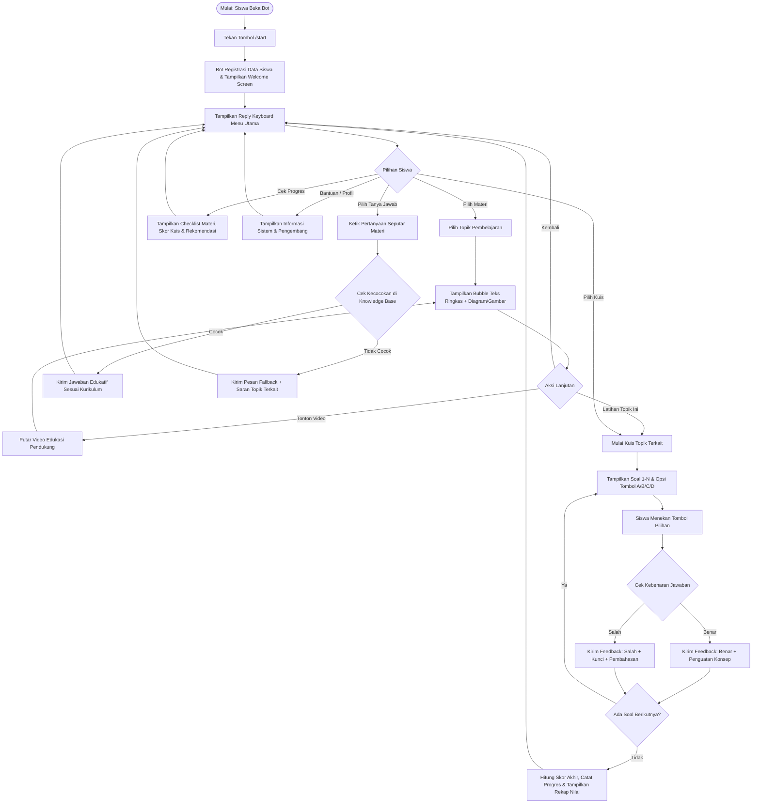
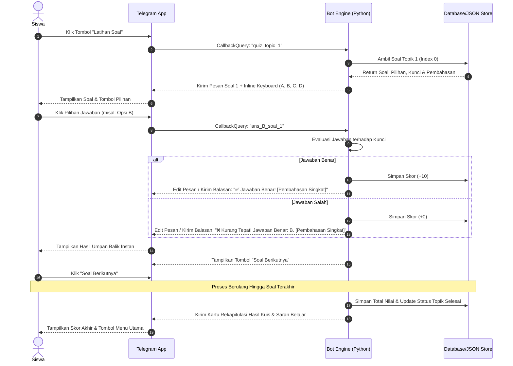

# PRODUCT REQUIREMENTS DOCUMENT (PRD)
## EduBot – Media Pembelajaran Informatika Berbasis Bot Telegram
**Mata Pelajaran:** Informatika (Elemen: Jaringan Komputer dan Internet)  
**Sasaran Pengguna:** Siswa Kelas X Program Keahlian Teknik Komputer dan Jaringan (TKJ)  
**Model Pengembangan:** ADDIE (Analysis, Design, Development, Implementation, Evaluation)  
**Versi Dokumen:** 1.0 (Final & Komprehensif)  
**Tanggal:** 2026-11-02  
**Pengembang:** Dasminar Hutasoit (Pendidikan Teknologi Informatika dan Komputer - UNIMED)  

---

## 1. PENYEMPURNAAN PERNYATAAN KEBUTUHAN (REFINED PROBLEM STATEMENT)

Berikut adalah perbaikan kalimat permintaan agar menjadi rumusan kebutuhan proyek yang formal, terstruktur, dan presisi:

> **Rumusan Kebutuhan Formal:**  
> *"Menyusun Product Requirements Document (PRD) yang komprehensif, terstruktur, dan terstandarisasi untuk pengembangan media pembelajaran interaktif berbasis Bot Telegram bernama **'EduBot - Media Pembelajaran Informatika'**. Media ini dirancang khusus untuk memfasilitasi pembelajaran mandiri siswa Kelas X TKJ pada materi Jaringan Komputer dan Internet dengan pendekatan terkontrol (*rule-based*). PRD ini memuat spesifikasi teknis dan fungsional secara bertahap dan menyeluruh—mulai dari analisis kebutuhan prasyarat, modul materi multimedia, sistem kuis adaptif dengan umpan balik langsung (*immediate feedback*), mesin tanya-jawab berbasis basis pengetahuan (*knowledge base*), pelacakan progres belajar, arsitektur data, alur percakapan (*storyboard* 15 *scenes*), hingga prosedur pengujian kelayakan dan efektivitas pembelajaran."*

---

## 2. RINGKASAN EKSEKUTIF & TUJUAN PRODUK

### 2.1 Identitas Produk
* **Nama Resmi Produk:** EduBot – Media Pembelajaran Informatika
* **Username Bot Telegram:** `@EduBotInformatikaBot` (atau disesuaikan dengan ketersediaan di BotFather)
* **Kategori Perangkat Lunak:** Computer-Assisted Instruction (CAI) / Mobile Learning via Conversational Agent (Chatbot)
* **Target Pengguna Primer:** Siswa Kelas X Jurusan Teknik Komputer dan Jaringan (TKJ) SMK 2 Telkom Medan
* **Target Pengguna Sekunder:** Pendidik/Guru Mata Pelajaran Informatika tingkat SMK

### 2.2 Latar Belakang & Urgensi
1. **Tingkat Kesulitan Materi Abstrak:** Berdasarkan studi pendahuluan, 52% siswa menyatakan materi Informatika sulit dipahami dan 66% menganggapnya sebagai mata pelajaran yang menantang, khususnya konsep abstrak dalam *Jaringan Komputer dan Internet* (seperti transmisi data, topologi, protokol komunikasi TCP/IP, dan pengalamatan jaringan).
2. **Kendala Aksesibilitas Bahan Ajar:** 61% siswa menilai metode konvensional kurang interaktif, serta kendala fisik seperti buku teks tertinggal di rumah menghambat proses belajar mandiri siswa di luar kelas.
3. **Kebutuhan Pembelajaran Terkendali (*Rule-Based*):** Chatbot pembelajaran harus bebas dari halusinasi data (tidak menggunakan AI generatif tanpa batas), melainkan menggunakan sistem berbasis aturan (*rule-based knowledge base*) dengan navigasi tombol interaktif (*inline & reply keyboard*) agar substansi materi 100% selaras dengan Capaian Pembelajaran (CP) Kurikulum Merdeka.

### 2.3 Tujuan Pengembangan
* Menyediakan media pembelajaran mandiri yang dapat diakses kapan saja dan di mana saja (24/7) dengan kuota hemat dan ringan.
* Memberikan penjelasan bertahap yang dilengkapi representasi visual diagramatik dan video edukasi.
* Meningkatkan penguasaan kognitif siswa melalui latihan soal interaktif dengan umpan balik instan (*direct explanation*).
* Memfasilitasi siswa memantau progres belajarnya secara transparan melalui *dashboard chat*.

---

## 3. PROFIL PENGGUNA & LINGKUNGAN OPERASIONAL

### 3.1 Karakteristik Pengguna
| Atribut | Pengguna Siswa (Pelajar) | Pengguna Guru / Administrator |
| :--- | :--- | :--- |
| **Tingkat Pendidikan** | Siswa Kelas X SMK Program Keahlian TKJ | Guru Mata Pelajaran / Peneliti |
| **Literasi Teknologi** | Menengah (terbiasa dengan *smartphone* dan aplikasi pesan instan) | Mahir (menguasai pedagogi dan teknis evaluasi) |
| **Kebutuhan Utama** | Penjelasan ringkas, visual, interaktif, latihan soal berkunci | Pemantauan hasil belajar, validitas materi kurikulum |
| **Perangkat Akses** | Ponsel pintar (Android / iOS) atau Laptop / PC | Laptop / PC / Ponsel pintar |

### 3.2 Kebutuhan Sistem & Lingkungan Operasional
* **Sisi Klien (Siswa):**
  * Perangkat: Ponsel Android (v7.0+), iOS (v12.0+), atau Telegram Desktop (Windows/macOS/Linux).
  * Aplikasi: Telegram Messenger versi terbaru.
  * Jaringan: Koneksi internet minimal 3G/4G stabil atau Wi-Fi (kecepatan rekomendasi minimal 2 Mbps).
* **Sisi Server (Hosting & Bot Engine):**
  * Runtime Environment: Python 3.10 atau versi di atasnya.
  * Dependensi Utama: `python-telegram-bot` (versi 20.x ke atas yang mendukung `asyncio`) atau `aiogram` (versi 3.x).
  * Manajemen Data: Local SQLite DB & Structured JSON Store.
  * Server Penyedia: Virtual Private Server (VPS) / Webhook Server (misal: Railway / VPS Ubuntu) atau Localhost dengan tunneling (*ngrok*) untuk tahap pengujian.

---

## 4. LINGKUP MATERI & KURIKULUM

Materi pembelajaran diadopsi secara resmi dari **Capaian Pembelajaran (CP) Informatika Elemen Jaringan Komputer dan Internet (JKI) Kelas X SMK (Kurikulum Merdeka)**, yang dipecah menjadi 3 Topik Utama:

```
├── TOPIK 1: MENGENAL JARINGAN KOMPUTER & INTERNET
│   ├── Pengertian Jaringan Komputer & Manfaatnya
│   ├── Jaringan Lokal (LAN): Ethernet (Kabel UTP/STP) & Wireless LAN (Wi-Fi)
│   ├── Internet & World Wide Web (WWW)
│   └── Komponen Utama Jaringan: Client, Server, Network Interface Card (NIC), Switch, Router, Modem
│
├── TOPIK 2: MENGKONFIGURASI PERANGKAT JARINGAN
│   ├── Media Transmisi Data (Kabel vs Nirkabel)
│   ├── Pengenalan Pengalamatan Logis (IP Address IPv4 & Subnet Mask Dasar)
│   ├── Konfigurasi Sambungan Bluetooth (Pairing & File Sharing)
│   └── Konfigurasi Koneksi Nirkabel (Tethering Hotspot & Wi-Fi Client)
│
└── TOPIK 3: MENGOPERASIKAN PERANGKAT JARINGAN & TROUBLESHOOTING DASAR
    ├── Cara Kerja Transfer Data Client-Server
    ├── Pengenalan Protokol Komunikasi (HTTP, HTTPS, FTP, DNS, DHCP)
    ├── Pengujian Konektivitas Sederhana (Konsep Ping & Status Terhubung)
    └── Troubleshooting Dasar Masalah Sambungan Internet
```

---

## 5. SPESIFIKASI KEBUTUHAN FUNGSIONAL (FUNCTIONAL REQUIREMENTS)

| ID Fitur | Nama Fitur | Deskripsi & Aturan Fungsional |
| :--- | :--- | :--- |
| **FR-01** | **Inisialisasi & Onboarding (`/start`)** | Menangani pengguna pertama kali atau restart interaksi. Bot menyapa pengguna secara personal, mencatat User ID & Nama Akun Telegram, menampilkan identitas bot, materi pembelajaran, identitas kelas, serta memunculkan Reply Keyboard Menu Utama. |
| **FR-02** | **Menu Utama Terstruktur** | Menyajikan tombol navigasi persisten (Reply Keyboard) yang terdiri dari: `📖 Materi Pembelajaran`, `📝 Latihan Soal`, `🎬 Video Pembelajaran`, `💬 Tanya Jawab`, `📊 Cek Progres`, `👨‍💻 Profil Pengembang`, dan `❓ Bantuan`. |
| **FR-03** | **Modul Materi Pembelajaran** | Menampilkan daftar pilihan sub-topik materi (Topik 1, 2, 3) dalam bentuk Inline Keyboard. Setiap sub-materi disajikan dalam bubble ringkas, jelas, disertai ilustrasi gambar/diagram skematik komponen, serta tombol navigasi: `🎬 Tonton Video`, `📝 Latihan Topik Ini`, `➡️ Topik Berikutnya`, dan `🔙 Menu Utama`. |
| **FR-04** | **Modul Video Edukasi** | Menyajikan video pembelajaran pendukung berdurasi optimal (3–7 menit) per sub-topik, baik di-streaming langsung melalui Telegram video player internal maupun tautan interaktif, dilengkapi tombol `🔙 Kembali ke Materi` dan `🏠 Menu Utama`. |
| **FR-05** | **Modul Kuis & Latihan Interaktif** | Menyediakan bank soal 10 butir pertanyaan per topik (Pilihan Ganda A, B, C, D) menggunakan Inline Buttons. Mencegah manipulasi jawaban (tombol dikunci setelah diklik sekali). |
| **FR-06** | **Umpan Balik Instan (*Immediate Feedback*)** | Memberikan penilaian real-time: jika salah, bot menampilkan tanda ❌ beserta kunci jawaban yang benar dan penjelasan konseptual ringkas; jika benar, bot memberikan tanda ✅ dan penguatan konsep. Disertai skor sementara dan tombol `🔄 Coba Lagi` atau `➡️ Soal Berikutnya`. |
| **FR-07** | **Evaluasi & Rekapitulasi Nilai Akhir** | Menghitung persentase skor akhir, menampilkan jumlah jawaban benar/salah, memberikan badge predikat ("Sangat Baik", "Cukup", "Perlu Belajar Lagi"), serta memberikan rekomendasi materi yang wajib diulang. |
| **FR-08** | **Fitur Tanya Jawab Terkontrol (*Rule-Based NLP/KB*)** | Merespons pertanyaan pengguna berdasarkan pencocokan kata kunci (*keyword matching* & *synonym pattern*) dari Knowledge Base seputar Jaringan Komputer. Jika pertanyaan di luar domain, bot mengaktifkan *Fallback Handling* yang sopan dan mengarahkan kembali ke daftar materi. |
| **FR-09** | **Pelacakan Progres Belajar (*Progress Tracking*)** | Mencatat riwayat topik yang telah diselesaikan (tanda centang hijau `✅`), riwayat kuis, nilai rata-rata, dan saran belajar personal secara otomatis ke dalam penyimpanan data lokal. |
| **FR-10** | **Profil Pengembang & Panduan Bantuan** | Menampilkan identitas akademis peneliti, dosen pembimbing, instansi (UNIMED - SMK 2 Telkom Medan), serta daftar perintah sintaks resmi (`/start`, `/menu`, `/materi`, `/kuis`, `/progres`, `/bantuan`). |

---

## 6. SPESIFIKASI KEBUTUHAN NON-FUNGSIONAL (NON-FUNCTIONAL REQUIREMENTS)

1. **Performa & Responsivitas:**
   * Latensi respons bot terhadap klik tombol inline di bawah **1,5 detik** dalam kondisi internet normal.
   * Ukuran media gambar yang dikirim dikompresi di bawah **500 KB** per gambar agar cepat terunduh di perangkat siswa.
2. **Keandalan & Ketersediaan (*Availability*):**
   * Bot beroperasi dengan uptime **99%** selama masa uji coba dan penelitian.
   * Penanganan *error exception* (*Try-Except Block*) pada setiap *handler* agar bot tidak pernah *crash* saat menerima input tak terduga.
3. **Keamanan & Integritas Data (*Security*):**
   * Bot token Telegram dienkripsi dalam file `.env` (Environment Variable) dan tidak diunggah ke repositori publik.
   * Validasi masukan pengguna untuk mencegah eksekusi kode berbahaya atau injeksi data.
   * Data siswa yang disimpan hanya mencakup `Telegram User ID`, `First Name`, `Username`, dan riwayat progres kuis.
4. **Kemudahan Penggunaan (*Usability & Ergonomics*):**
   * *Zero Learning Curve*: Siswa tidak dituntut menghafal sintaks konsol; seluruh navigasi didominasi oleh tombol keyboard (*Touch-first interface*).
   * Format teks menggunakan tipografi rapi: huruf tebal (*bold*), miring (*italic*), *bullet points*, dan emoji fungsional untuk memudahkan pemindaian visual (*scannability*).

---

## 7. ARSITEKTUR SISTEM & DIAGRAM UML

### 7.1 Diagram Arsitektur Sistem
```
+-----------------------------------------------------------------+
|                      PERANGKAT PENGGUNA                         |
|   (Smartphone Android/iOS / Komputer Siswa & Guru)              |
|                                                                 |
|   [ Aplikasi Telegram Messenger: Teks, Inline Buttons, Media ]   |
+-------------------------------+---------------------------------+
                                │  Protokol HTTPS / JSON Payload
                                ▼
+-----------------------------------------------------------------+
|                    TELEGRAM BOT SERVER (CLOUD)                  |
|                   (Telegram Bot API Gateway)                    |
+-------------------------------+---------------------------------+
                                │  Long Polling / Webhook
                                ▼
+-----------------------------------------------------------------+
|             SERVER BACKEND APLIKASI (EDUBOT ENGINE)             |
|                                                                 |
|  ┌───────────────────────────────────────────────────────────┐  |
|  │                  Dispatcher & Router Engine               │  |
|  └───────────────┬───────────────────────────┬───────────────┘  |
|                  │                           │                  |
|  ┌───────────────▼───────────────┐ ┌─────────▼───────────────┐  |
|  │  Menu & Navigation Controller │ │  Quiz & Scoring Engine  │  |
|  └───────────────┬───────────────┘ └─────────┬───────────────┘  |
|                  │                           │                  |
|  ┌───────────────▼───────────────┐ ┌─────────▼───────────────┐  |
|  │ Controlled KB & Rule Matcher  │ │ Progress Track Service  │  |
|  └───────────────┬───────────────┘ └─────────┬───────────────┘  |
|                  │                           │                  |
|  ┌───────────────▼───────────────────────────▼───────────────┐  |
|  │             DATA PERSISTENCE & RESOURCE LAYER             │  |
|  │  • materials.json       • quiz_bank.json                  │  |
|  │  • knowledge_base.json  • edubot_database.sqlite          │  |
|  └───────────────────────────────────────────────────────────┘  |
+-----------------------------------------------------------------+
```

### 7.2 Use Case Diagram
* **Aktor:** Siswa Kelas X TKJ
* **Use Cases:**
  1. *Memulai Chatbot (`/start`)*
  2. *Mengakses Menu Utama*
  3. *Membaca Materi Pembelajaran (Mengenal Jaringan, Konfigurasi, Operasional)*
  4. *Menonton Video Edukasi*
  5. *Mengerjakan Latihan Soal / Kuis Interaktif*
  6. *Menerima Umpan Balik & Pembahasan Kunci Jawaban*
  7. *Melakukan Tanya Jawab Terkontrol (Knowledge Base)*
  8. *Memeriksa Progres Belajar (`/progres`)*
  9. *Melihat Profil Pengembang & Panduan Bantuan*

### 7.3 Activity Diagram (Alur Utama Pembelajaran)


### 7.4 Sequence Diagram (Mengerjakan Latihan Soal & Umpan Balik)


---

## 8. STRUKTUR DATA & SKEMA BASIS DATA

Untuk memastikan konsistensi dan efisiensi, penyimpanan data diatur secara hibrida: konten pembelajaran dikelola dalam file JSON terstruktur (*Content As Data*), sedangkan aktivitas siswa dicatat ke dalam basis data relasional SQLite.

### 8.1 Skema Basis Data SQLite (`edubot_database.sqlite`)

#### Tabel 1: `students` (Data Identitas Pengguna)
```sql
CREATE TABLE IF NOT EXISTS students (
    telegram_id INTEGER PRIMARY KEY,
    username TEXT,
    full_name TEXT NOT NULL,
    class_name TEXT DEFAULT 'X TKJ',
    registered_at DATETIME DEFAULT CURRENT_TIMESTAMP,
    last_active DATETIME DEFAULT CURRENT_TIMESTAMP
);
```

#### Tabel 2: `topic_progress` (Progres Belajar Materi)
```sql
CREATE TABLE IF NOT EXISTS topic_progress (
    progress_id INTEGER PRIMARY KEY AUTOINCREMENT,
    telegram_id INTEGER,
    topic_id INTEGER NOT NULL,          -- 1: Mengenal Jaringan, 2: Konfigurasi, 3: Operasi
    is_completed INTEGER DEFAULT 0,     -- 0: Belum, 1: Selesai
    video_watched INTEGER DEFAULT 0,    -- 0: Belum, 1: Sudah
    completed_at DATETIME,
    FOREIGN KEY(telegram_id) REFERENCES students(telegram_id)
);
```

#### Tabel 3: `quiz_attempts` (Riwayat Pengerjaan Kuis)
```sql
CREATE TABLE IF NOT EXISTS quiz_attempts (
    attempt_id INTEGER PRIMARY KEY AUTOINCREMENT,
    telegram_id INTEGER,
    topic_id INTEGER NOT NULL,
    total_questions INTEGER NOT NULL,
    correct_answers INTEGER NOT NULL,
    final_score REAL NOT NULL,          -- Skala 0 - 100
    attempted_at DATETIME DEFAULT CURRENT_TIMESTAMP,
    FOREIGN KEY(telegram_id) REFERENCES students(telegram_id)
);
```

### 8.2 Skema File Konten JSON

#### Struktur Bank Soal (`quiz_bank.json`)
```json
{
  "topik_1": [
    {
      "id": 1,
      "question": "Apa yang dimaksud dengan jaringan komputer?",
      "options": [
        {"key": "A", "text": "Kumpulan titik kabel yang terisolasi tanpa aliran data"},
        {"key": "B", "text": "Jaringan telekomunikasi yang memungkinkan antar komputer saling bertukar data"},
        {"key": "C", "text": "Perangkat keras komputer yang berdiri sendiri tanpa koneksi"},
        {"key": "D", "text": "Aplikasi peramban web untuk membuka situs internet"}
      ],
      "correct": "B",
      "explanation": "Jaringan komputer adalah sistem yang menghubungkan dua atau lebih komputer untuk berbagi data, sumber daya, dan komunikasi."
    }
  ]
}
```

#### Struktur Basis Pengetahuan Tanya Jawab (`knowledge_base.json`)
```json
{
  "faq": [
    {
      "intent": "pengertian_lan",
      "keywords": ["lan", "local area network", "jaringan lokal", "apa itu lan"],
      "answer": "🌐 **Local Area Network (LAN)** adalah jaringan komputer yang mencakup wilayah geografis kecil, seperti laboratorium sekolah, kantor, atau rumah. Di SMK 2 Telkom Medan, LAN di lab TKJ umumnya menggunakan kabel Ethernet (UTP) atau Wi-Fi.",
      "related_topic": "Topik 1: Mengenal Jaringan"
    },
    {
      "intent": "fungsi_router",
      "keywords": ["router", "fungsi router", "alat router"],
      "answer": "📡 **Router** berfungsi menghubungkan dua atau lebih jaringan yang memiliki subnet/segmen berbeda, serta merutekan paket data melalui jalur terbaik menuju alamat IP tujuan.",
      "related_topic": "Topik 1: Komponen Jaringan"
    }
  ],
  "fallback_response": "⚠️ **Pertanyaan Tidak Dikenali**\nMaaf, pertanyaan Anda berada di luar cakupan materi *Jaringan Komputer dan Internet*. Silakan ajukan pertanyaan terkait konsep jaringan, komponen, konfigurasi, atau gunakan tombol **Daftar Pertanyaan** di bawah."
}
```

---

## 9. STORYBOARD RINCI (15 SCENES PERCAKAPAN)

Sesuai rancangan pada penelitian, interaksi didesain ke dalam **15 Scene Percakapan** yang teratur, konsisten, dan bebas dari kebingungan navigasi:

| Scene | Nama Tampilan | Elemen Visual & Isi Teks Bot | Komponen Interaktif (Tombol) | Aksi Sistem |
| :---: | :--- | :--- | :--- | :--- |
| **01** | **Halaman Awal (`/start`)** | Banner Header Bot: EduBot Pembelajaran Informatika. Salam pembuka ramah, penjelasan identitas media untuk Kelas X TKJ SMK 2 Telkom Medan. | Tombol Bawaan Telegram: `[ START ]` | Mendaftarkan Telegram ID pengguna ke database dan menampilkan Scene 02. |
| **02** | **Menu Utama** | Bubble Chat: *"Selamat datang di EduBot! Pilih menu di bawah untuk memulai pembelajaran mandiri:"* | **Reply Keyboard (Persisten):**<br>• `📖 Materi Pembelajaran`<br>• `📝 Latihan Soal`<br>• `🎬 Video Pembelajaran`<br>• `💬 Tanya Jawab`<br>• `📊 Cek Progres`<br>• `👨‍💻 Profil Pengembang`<br>• `❓ Bantuan` | Mengarahkan ke router handler sesuai tombol yang ditekan. |
| **03** | **Daftar Topik Materi** | Judul: `📚 MATERI PEMBELAJARAN INFORMATIKA`<br>Instruksi: Silakan pilih topik bahasan yang ingin dipelajari: | **Inline Keyboard:**<br>`[ 1. Mengenal Jaringan Komputer ]`<br>`[ 2. Mengkonfigurasi Perangkat Jaringan ]`<br>`[ 3. Mengoperasikan Perangkat Jaringan ]`<br>`[ 🔙 Kembali ke Menu Utama ]` | Mengambil konten materi dari `materials.json` berdasarkan ID topik. |
| **04** | **Halaman Isi Materi** | Menampilkan judul sub-topik, teks ringkasan materi berpoin, dan placeholder infografis/gambar skema topologi LAN yang jelas. | **Inline Keyboard:**<br>`[ 🎬 Tonton Video Penjelasan ]`<br>`[ 📝 Latihan Soal Topik Ini ]`<br>`[ ➡️ Topik Berikutnya ]`<br>`[ 🏠 Menu Utama ]` | Mengirim gambar dengan caption terformat markdown; mencatat status baca topik. |
| **05** | **Halaman Video Edukasi** | Header: `🎬 VIDEO PENJELASAN TOPIK`<br>Pesan pengantar dan kartu video tersemat (durasi 5:30 menit) dengan judul materi terkait. | **Inline Keyboard:**<br>`[ 🔙 Kembali ke Materi ]`<br>`[ 🏠 Menu Utama ]` | Memutar video langsung di Telegram; mencatat histori tonton di tabel `topic_progress`. |
| **06** | **Halaman Soal Kuis** | Header Soal: `📝 SOAL [X] DARI 10`<br>Teks pertanyaan pilihan ganda yang dirumuskan secara ilmiah sesuai kisi-kisi instrumen. | **Inline Keyboard (4 Pilihan):**<br>`[ A. Opsi Jawaban A ]`<br>`[ B. Opsi Jawaban B ]`<br>`[ C. Opsi Jawaban C ]`<br>`[ D. Opsi Jawaban D ]` | Mengunci tombol setelah diklik agar siswa tidak dapat mengganti jawaban berulang kali. |
| **07A**| **Feedback Jawaban Benar** | Bubble Balasan: `✅ JAWABAN BENAR!`<br>Kunci: Pilihan yang dipilih.<br>Ulasan Konsep Singkat.<br>Skor Sementara: `[X]/10`. | **Inline Keyboard:**<br>`[ ➡️ Soal Berikutnya ]` | Menambah poin pengguna (+10), merekam jawaban ke riwayat sesi aktif. |
| **07B**| **Feedback Jawaban Salah** | Bubble Balasan: `❌ KURANG TEPAT`<br>Kunci Jawaban Seharusnya: `[Kunci Benar]`.<br>Penjelasan: Konsep dasar mengapa opsi tersebut yang benar.<br>Skor Sementara: `[X]/10`. | **Inline Keyboard:**<br>`[ 🔄 Coba Ulangi Soal Ini ]`<br>`[ ➡️ Soal Berikutnya ]` | Mencatat evaluasi jawaban; memberikan hak remidi instan jika diperlukan. |
| **08** | **Kartu Hasil Akhir Kuis** | Ringkasan Evaluasi:<br>`🏆 HASIL EVALUASI KUIS`<br>Topik: *Mengenal Jaringan*<br>Skor Akhir: `80 / 100 (80%)`<br>Detail: ✅ 8 Benar \| ❌ 2 Salah<br>Predikat: *Tuntas / Sangat Baik*<br>Rekomendasi: *"Perdalam konsep Subnet Mask & Protokol TCP/IP ya!"* | **Inline Keyboard:**<br>`[ 📖 Baca Ulang Materi ]`<br>`[ 🔄 Ulangi Kuis ]`<br>`[ 🏠 Menu Utama ]` | Menyimpan record permanen ke tabel `quiz_attempts`; memperbarui rata-rata skor siswa. |
| **09** | **Fitur Tanya Jawab (Awal)**| Header: `💬 TANYA JAWAB EDUKATIF`<br>Petunjuk: Ketik pertanyaan Anda menggunakan kata kunci terkait materi (misal: *"Apa itu router?"*, *"Fungsi LAN"*). | **Inline Keyboard:**<br>`[ 📋 Lihat Daftar Pertanyaan Populer ]`<br>`[ 🏠 Menu Utama ]` | Mengaktifkan state `WAITING_USER_QUESTION` pada ConversationHandler bot. |
| **10** | **Tanya Jawab: Dikenali** | Menampilkan jawaban komprehensif dari *Knowledge Base* yang terkontrol, bebas bias dan sesuai kurikulum SMK. | **Inline Keyboard:**<br>`[ 💬 Tanya Pertanyaan Lain ]`<br>`[ 🏠 Menu Utama ]` | Mencocokkan teks pengguna dengan regex/keyword JSON; menyajikan jawaban presisi. |
| **11** | **Tanya Jawab: Fallback** | Pesan Peringatan Sopan: `⚠️ Pertanyaan Di Luar Jangkauan`<br>Penjelasan bahwa EduBot dikhususkan untuk materi Informatika SMK 2 Telkom Medan. | **Inline Keyboard:**<br>`[ 📋 Lihat Daftar Pertanyaan ]`<br>`[ 📖 Buka Materi Pembelajaran ]`<br>`[ 🏠 Menu Utama ]` | Guardrail sistem untuk menjaga bot tetap fokus pada tujuan pedagogis. |
| **12** | **Daftar Pertanyaan Cepat (FAQ)**| Daftar pertanyaan siap-klik yang sering ditanyakan siswa seputar materi Jaringan Komputer. | **Inline Keyboard (Vertikal):**<br>`[ Apa itu Jaringan Komputer? ]`<br>`[ Apa saja komponen LAN? ]`<br>`[ Bagaimana cara kerja IP Address? ]`<br>`[ 🏠 Menu Utama ]` | Menghindari siswa repot mengetik secara manual di perangkat mobile. |
| **13** | **Cek Progres Belajar** | Header: `📊 PROGRES BELAJAR SAYA`<br>Nama: `[Nama Siswa]` \| Kelas: `X TKJ`<br>• Topik Selesai: `2 dari 3 Topik` `[██████░░] 66%`<br>• Status Kuis: Rata-rata Skor `85.0`<br>• Rekomendasi: *"Selesaikan Topik 3 untuk menuntaskan materi!"* | **Inline Keyboard:**<br>`[ 🚀 Lanjutkan Belajar ]`<br>`[ 🏠 Menu Utama ]` | Meng-query tabel `topic_progress` dan `quiz_attempts` lalu menghasilkan status visual. |
| **14** | **Profil Pengembang & Riset**| Informasi Ilmiah: Profil Peneliti (Dasminar Hutasoit / NIM 5213351036), Pembimbing (Prof. Dr. Hamonangan Tambunan, S.T., M.Pd.), Prodi PTIK UNIMED, Lokasi Penelitian (SMK 2 Telkom Medan). | **Inline Keyboard:**<br>`[ 🏠 Kembali ke Menu Utama ]` | Memberikan kredibilitas akademik dan transparansi pengembang produk. |
| **15** | **Pusat Bantuan (`/help`)** | Panduan Operasional Bot: Tata cara mengoperasikan menu, daftar perintah cepat (`/start`, `/menu`, `/materi`, `/kuis`, `/progres`), dan solusi bila bot tidak merespons. | **Inline Keyboard:**<br>`[ 🏠 Kembali ke Menu Utama ]` | Menyediakan pertolongan pertama mandiri bagi pengguna awam. |

---

## 10. ROADMAP PENGEMBANGAN BERTAHAP (MODEL ADDIE)

Pengembangan dieksekusi secara disiplin mengikuti model **ADDIE (Analysis, Design, Development, Implementation, Evaluation)** untuk menjamin mutu produk:

```
    [ 1. ANALYSIS ]  ──▶  [ 2. DESIGN ]   ──▶  [ 3. DEVELOPMENT ]
    • Observasi Kelas     • Storyboard 15 Sc.   • Setup BotFather & Token
    • Wawancara Guru      • Desain JSON & DB    • Coding Handler Python
    • Analisis Kurikulum  • Instrumen Validasi  • Integrasi Modul Kuis
                                                       │
    [ 5. EVALUATION ] ◀── [ 4. IMPLEMENTATION ] ◀──────┘
    • Uji Kelayakan Ahli  • Uji Coba Terbatas (X TKJ)
    • Uji Akseptabilitas  • Pre-test & Post-test
    • Hitung Skor N-Gain  • Pengumpulan Angket Siswa
```

### Tahap 1: Analisis (*Analysis*)
1. Melakukan observasi lingkungan belajar di Kelas X TKJ SMK 2 Telkom Medan.
2. Menganalisis Capaian Pembelajaran (CP) dan Alur Tujuan Pembelajaran (ATP) mata pelajaran Informatika Kurikulum Merdeka.
3. Mengidentifikasi kendala siswa (kesulitan konsep abstrak, buku tertinggal, kebutuhan repetisi materi).
4. Menentukan platform Telegram sebagai media paling tepat (ringan, hemat kuota, berbasis cloud, API kaya fitur).

### Tahap 2: Perancangan (*Design*)
1. Merumuskan struktur navigasi dan menyusun naskah percakapan (*dialog script*).
2. Merancang storyboard 15 *scenes* visual antarmuka percakapan.
3. Menyusun bank materi, infografis diagram jaringan, serta bank soal kuis (10 soal per topik dilengkapi pembahasan).
4. Merancang skema basis data SQLite dan struktur kamus data JSON.
5. Menyusun instrumen uji kelayakan (ahli materi & ahli media) dan instrumen respon siswa (akseptabilitas).

### Tahap 3: Pengembangan (*Development*)
1. Pembuatan bot di BotFather untuk mendapatkan Bot Token resmi.
2. Konfigurasi struktur repositori proyek Python:
   * `main.py`: Entry point & inisialisasi bot.
   * `handlers/`: Pemisah modul (start, menu, materi, kuis, tanya jawab, progres).
   * `data/`: Penyimpanan `materials.json`, `quiz_bank.json`, `knowledge_base.json`.
   * `database/`: Skrip koneksi dan query SQLite (`db_helper.py`).
3. Pengkodean State Machine menggunakan `ConversationHandler` dari pustaka Telegram Bot.
4. Uji coba fungsional internal (*Black-box testing*) terhadap seluruh tombol inline dan alur percakapan.
5. Melakukan validasi produk kepada:
   * **Ahli Materi:** Menilai kebenaran konsep, kesesuaian kurikulum, dan kualitas bahasa ajar.
   * **Ahli Media:** Menilai tata letak interaksi, kemudahan navigasi, kejelasan petunjuk, dan konsistensi tombol.

### Tahap 4: Penerapan (*Implementation*)
1. Mengimplementasikan bot kepada subjek penelitian (siswa Kelas X TKJ SMK 2 Telkom Medan).
2. Melaksanakan pembelajaran berbantuan EduBot:
   * Sesi pembelajaran materi mandiri.
   * Pelaksanaan sesi kuis interaktif.
   * Eksplorasi fitur tanya jawab.
3. Pengambilan data hasil belajar (Pre-test sebelum menggunakan bot dan Post-test setelah menggunakan bot).

### Tahap 5: Evaluasi (*Evaluation*)
1. **Analisis Kelayakan:** Menghitung persentase skor validasi dari Ahli Materi dan Ahli Media dengan rumus kelayakan produk:
   $$\text{Persentase Kelayakan} = \frac{\sum \text{Skor Riil}}{\sum \text{Skor Maksimal}} \times 100\%$$
   *Kriteria: Sangat Layak (81% - 100%), Layak (61% - 80%).*
2. **Analisis Akseptabilitas Siswa:** Menilai tingkat kemudahan dan kepuasan siswa menggunakan angket skala Likert.
3. **Analisis Efektivitas Pembelajaran:** Menghitung peningkatan hasil belajar siswa melalui nilai *Normalized Gain (N-Gain)*:
   $$g = \frac{\text{Posttest} - \text{Pretest}}{\text{Skor Maksimal} - \text{Pretest}}$$
   *Kriteria: Efektif / Tinggi ($g > 0.7$), Sedang ($0.3 \leq g \leq 0.7$).*

---

## 11. MATRIKS TESTING & QUALITY ASSURANCE (QA)

| ID Uji | Kasus Pengujian | Tindakan Pengujian | Hasil yang Diharapkan | Status |
| :--- | :--- | :--- | :--- | :---: |
| **TC-01** | Perintah `/start` | Pengguna mengirim `/start` | Bot membalas ucapan selamat datang & memunculkan Reply Keyboard Menu Utama. | Passed |
| **TC-02** | Navigasi Menu Materi | Klik `📖 Materi Pembelajaran` | Bot menampilkan 3 opsi sub-topik materi via Inline Keyboard. | Passed |
| **TC-03** | Pembacaan Konten Materi| Klik `Topik 1: Mengenal Jaringan` | Bot mengirimkan teks penjelasan terstruktur + gambar diagram skema LAN. | Passed |
| **TC-04** | Pemutaran Video Edukasi | Klik `🎬 Tonton Video Penjelasan` | Bot mengirimkan kartu video edukasi yang siap diputar langsung. | Passed |
| **TC-05** | Mekanisme Kuis & Kunci | Klik opsi jawaban kuis | Tombol dinonaktifkan (mencegah klik ganda); umpan balik dan skor langsung terbit. | Passed |
| **TC-06** | Tanya Jawab Terkontrol | Ketik *"Apa fungsi router?"* | Bot mengenali intent dan membalas fungsi router sesuai kurikulum TKJ. | Passed |
| **TC-07** | *Fallback Handling* | Ketik hal acak / di luar materi | Bot membalas sopan: pertanyaan di luar konteks & menawarkan tombol FAQ. | Passed |
| **TC-08** | Akurasi Progres | Klik `📊 Cek Progres` | Tampil persentase topik yang selesai dan riwayat nilai kuis yang presisi. | Passed |
| **TC-09** | Ketahanan *Crash* | Input berupa stiker, audio, file | Bot tidak *crash*, melainkan membalas dengan instruksi navigasi yang benar. | Passed |

---

## 12. KESIMPULAN & TAHAP SELANJUTNYA

PRD ini menjadi **blueprint definitif 100% konsisten** untuk membangun **EduBot - Media Pembelajaran Informatika**. Melalui arsitektur terkontrol (*rule-based*), navigasi inline yang intuitif, serta penataan data yang terpisah antara konten (JSON) dan rekam jejak pengguna (SQLite), pengembang dapat langsung melanjutkan ke tahap *coding* pembuatan bot menggunakan Python.

Dokumen ini secara resmi menjadi acuan teknis dalam penyusunan Laporan Skripsi dan Uji Validasi Produk di SMK 2 Telkom Medan.
